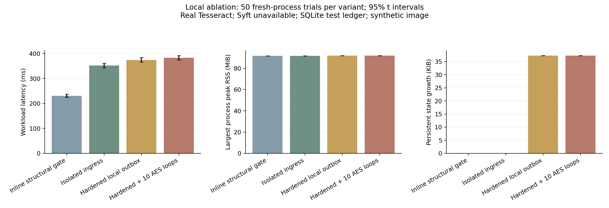
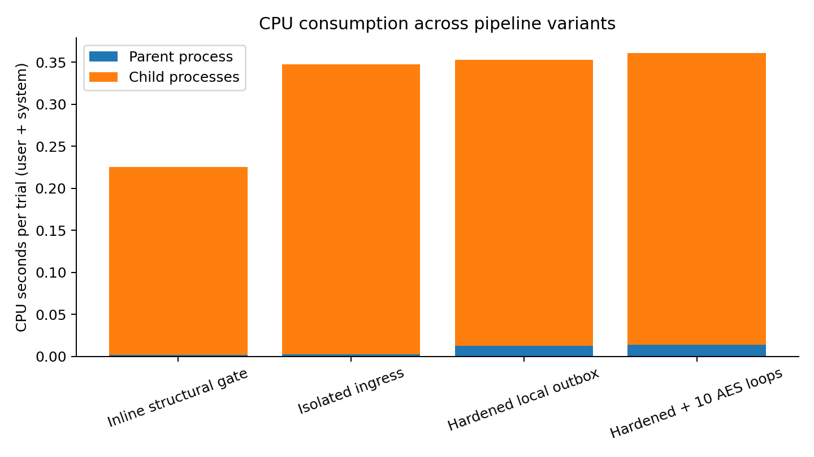
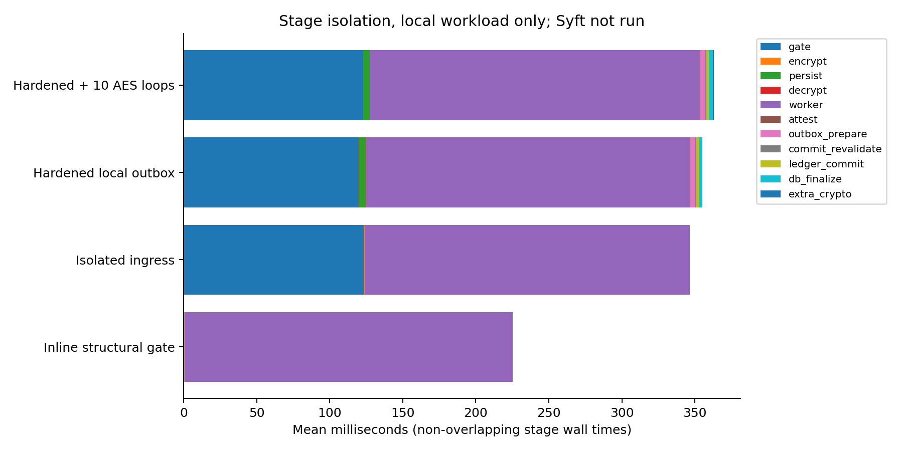

# Evidence status — 30 October 2026

The repository has been repaired and tested, but the requested publication matrix
is not complete. The absent manuscript and private corporate corpus cannot be
reconstructed from the supplied repository or audit notes.

## Measured security results

The final generated corpus contains 1,000 benign synthetic documents and 86 inert
adversarial specimens. The isolated structural gate observed:

| Outcome | Observed errors / specimens | Nominal exact two-sided 95% interval |
| --- | --- | --- |
| Adversarial bypass rate | 0 / 86 | 0–4.20% |
| False-rejection rate | 0 / 1,000 | 0–0.368% |

These intervals assume a binomial sampling model. Hand-generated related
specimens are not a random sample of all possible corporate files or attacks;
the intervals are not real-world exploit-risk guarantees. Zero observed errors
must not be generalized to unseen families. No historical corporate corpus was
validated. The archived exact fixtures are
[`generated-corpus.zip`](../research/fixtures/generated-corpus.zip), SHA-256
`8238cb4bef2242ae4c2b084e9684cad71d77811e8f508bf3c6c09990193cb2e4`.
The per-specimen report retains the manifest hash, specimen hashes and decisions.

The header-only ablation admits 70/86 adversarial specimens; the structural gate
admits 0/86 on the same bytes. Both admit the 1,000 generated benign documents.
This establishes a defensive benefit on this corpus, not malware coverage or a
claim that every architecture stage is universally necessary.

## Measured local stage ablation

Each variant has 50 fresh-process trials after three discarded warm-ups. Variant
order is randomized within trial blocks. These are local SQLite-reference trials
on one 1,338-byte generated PNG with real Tesseract. Syft was unavailable in this
local environment and is recorded as null. The isolated comparator and hardened
variant do different persistence work; the measured delta is an architectural
comparison, not a pure single-variable causal estimate.

| Variant | Mean workload latency | Sample SD | 95% t interval |
| --- | ---: | ---: | ---: |
| Structural inline | 230.99 ms | 22.35 ms | 224.64–237.34 ms |
| Isolated ingress pipeline | 352.41 ms | 30.79 ms | 343.65–361.16 ms |
| Hardened local outbox | 374.77 ms | 32.67 ms | 365.49–384.05 ms |
| Hardened plus ten extra AES loops | 383.17 ms | 31.52 ms | 374.21–392.13 ms |

The paired hardened-minus-isolated delta is **22.36 ms**, 95% CI **12.81–31.91 ms**.
The directly instrumented local signature/outbox/revalidation/finalization stages
sum to **6.70 ms**, 95% CI **6.36–7.05 ms**. External consensus latency is absent
from these local deltas. CPU, largest-process RSS and disk-growth measurements
are retained in raw logs and the figures; largest-process RSS is not aggregate
concurrent system RSS.

## Actual Fabric integration

[GitHub run 41026779493](https://github.com/bruce12-glitch/Vendorchain-Research/actions/runs/41026779493)
passed Python tests, Gateway tests, Go race tests/vet and the BFT integration job
at source commit `b2947886d01aefa3b2d7efbbb1b4714c8eb07fb8`.
The job verified a committed channel with four BFT consenters, executed real
Tesseract and Syft, and confirmed three uploads per burst. It passed both the
healthy and one-orderer-crash conditions. There was one measured trial per
condition and one healthy warm-up: this is an integration smoke test.
The actual channel configuration, image IDs, request timings and provenance are
retained in `research/results/bft-smoke/`. All orderers and peers shared one
GitHub runner; development certificates were used. No malicious-orderer or
cross-host network-partition test was executed.

A separate 100-upload, 50-trial campaign was launched at source commit
`7c87d18cb60ca6dfcd6ce2e48f2e5f5564dff911`:
[run 41027758083](https://github.com/bruce12-glitch/Vendorchain-Research/actions/runs/41027758083).
Its final outcome will be recorded with the downloaded raw artifact. Starting a
run is not a measured result.

## Remaining publication requirements

| Requested evidence | Status |
| --- | --- |
| Multi-node consensus execution | Four-orderer BFT integration passed; all nodes colocated |
| 100-upload N ≥ 50 campaign | Running; pending final raw artifact review |
| 250–10,000 upload N ≥ 50 sweeps | Runner implemented; not executed |
| Production workload/host/network fidelity | Not established by the colocated test network |
| Historical corporate false-rejection study | Corpus not supplied; manifest evaluator implemented |
| GIF/PE and validated live parser-exploit corpus | Not supplied or claimed; inert structural specimens tested |
| Full OCR/Syft/resource ablation on production topology | Local OCR ablation completed; external full matrix pending |
| Formal manuscript H1–H7 alignment | Operational mapping implemented; manuscript definitions absent |
| Publication-ready claim that all requested results are obtained | Not supported |

The implementation adds the mechanisms needed to run these experiments. It does
not manufacture the measurements or redefine a development test as production
validation.
